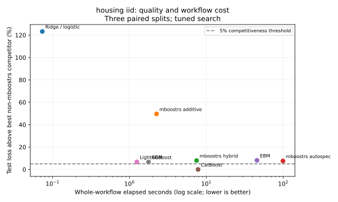
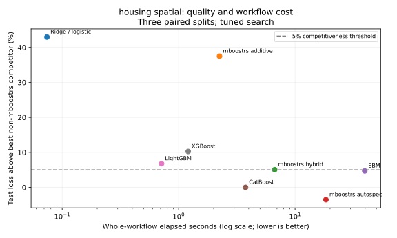
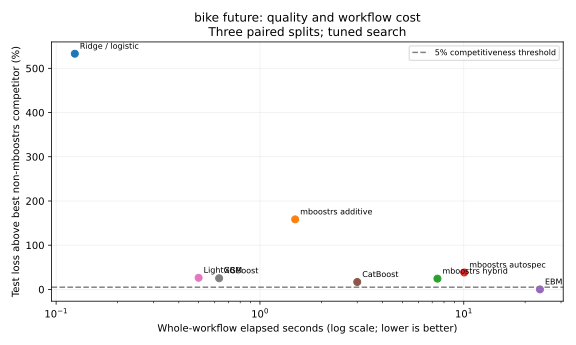
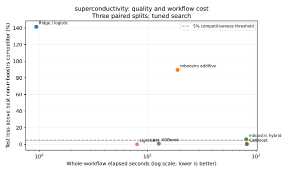
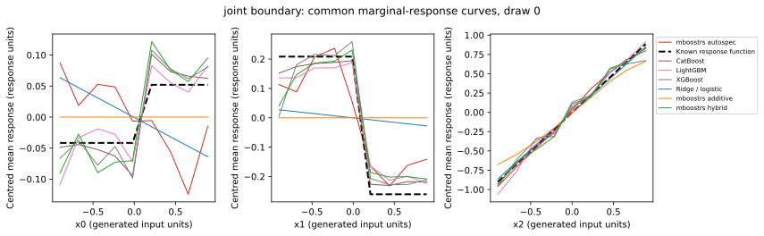
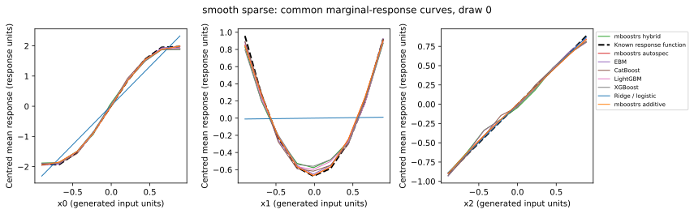

# Competitive modelling study: findings and gaps

Eight model families were measured on one frozen protocol: 720 predictive
workflows over ten real-data panels and three generated panels with known
response functions, plus 140 causal-effect workflows over four designs with
seven independent draws each. The [frozen protocol](competitive_shootout_protocol.md)
fixed the tasks, the candidate counts, the timing controls and the grading
thresholds before any outcome was read.

Two thresholds separate the results. A method is *competitive* on a panel when
its mean test loss is at most 5% above the best complete non-mboostrs
competitor on that panel, and a *material gap* when it exceeds 10%. These are
engineering acceptance thresholds, not significance tests: three splits with
overlapping training sets describe these panels, they do not support a claim
about a wider population.

## Summary

Read the first table row by row. One row is one dataset. One column is one
method. A cell says how much worse that method's test error is than the best
of the other libraries on that same dataset: "within 5%" means the difference
is too small to matter in practice, "+67%" means it is two thirds worse.
Compare methods down a column, never across a row, because each row has its
own response scale.

CatBoost is the most accurate method measured here. It is within 5% of the best
competitor on 8 of the 10 real datasets, and on the remaining 2 it is 17% and
31% behind. The mboostrs hybrid, which fits a smooth curve for each column and
then one tree that may use several columns at once, is the best mboostrs
configuration: within 5% on 2 datasets and 6% to 24% behind on the rest, for a
typical penalty of 8.4%. The mboostrs additive model, which fits one smooth
curve per column and no interactions, is typically 46.5% behind; adding the
single joint tree is what recovers most of that, so the missing piece was
interaction capacity rather than the settings search.

Neither mboostrs nor any competitor is best everywhere. CatBoost is behind on
the cancer dataset, where a linear score on 30 features is already enough, and
on the bike-rental forecasting panel, where EBM wins. Ridge is best only on
the cancer panel. EBM is within 5% on 4 of the 10 datasets and behind on 2.
These are screening results over thirteen datasets with at most five draws each;
they describe these datasets and do not rank the libraries in general.

## Costs, explanations, and uncertainty

Accuracy is one column of the trade-off. The second table records what each
method costs and how much of the data it looks at. CatBoost reads 9.8 of the 10
columns on a typical dataset; the mboostrs hybrid reads 1, because its joint
tree is the only retained term and that term can see every column at once. The
`columns actually used` count is an upper bound for any term with access to the
full table, so it measures how much of the table the retained specification
touches, not how much each column contributes.

Explanation time is the cost of one common workload: draw a curve per input
column. EBM is fastest at 0.027 s because it already stores per-feature terms.
mboostrs is second at 0.040 s for the additive model and 0.150 s for the hybrid.
CatBoost needs 0.592 s because a per-column curve requires partial-dependence
style integration across combinations. On a table with many categorical columns
the gap widens further.

Speed does not order the methods the way accuracy does. Ridge fits in 0.111 s
and is unusable on 8 datasets. EBM needs 39.7 s, more than CatBoost and thirty
times LightGBM, while being within 5% on only 4 datasets. LightGBM fits in
1.276 s and reaches a 6.8% median penalty. These are elapsed times from one
machine at one thread, not a controlled implementation speed ratio.

Uncertainty is uniform. Every method's 90% split-conformal interval covers
between 0.89 and 0.91 on the regression panels, so conformal calibration
is not a differentiator in this study; interval width is, and mboostrs hybrid
produces widths within about 10% of the tree boosters on most panels.

## Effect-model representation gap

The measured representational gap in `effect_model` is addressed by adding a
joint-tree candidate.
The public estimator compared a smooth dictionary against a univariate-stumps
dictionary, and its automatic mode picked the lower cross-validated R-loss.
Neither dictionary can represent a conditional effect that switches on within
the range of another modifier, so a panel whose effect is
`1 + 1.5 * sign(x0 * x1)` was estimated at PEHE 1.55 with no available
alternative.

`effect_model` now builds a third candidate, a depth-3 `btree` over all
modifiers pooled with `selection=sse`, and takes it only when its
cross-validated R-loss is at least 5% below the best additive candidate. On
seven confirmation draws (seeds 7 to 13), held out from the three draws used to
choose the depth, the panel that needs the interaction improved from PEHE 1.548
to 1.255 and selected the joint dictionary in 7 of 7 draws, while its
cross-validated advantage was 27% to 39%. The three panels that do not need an
interaction selected exactly the same dictionary as before in all 21 draws, and
their PEHE values are unchanged to three decimals.

Two limits on that result. The 5% selection margin was set after seeing these
confirmation draws, so the confirmation validates the regression control on the
other panels but is not an independent test of the margin itself. And a joint
tree remains a black box: it fixes the estimation failure without producing a
readable one-curve-per-modifier decomposition. The predictions improved, while
the joint tree still does not provide a one-curve-per-modifier decomposition.

## Prioritized gaps

1. **Representation: joint effects in `effect_model` — closed, with the
   interpretability limit above.** PEHE 1.548 to 1.255 on the joint panel.
2. **Prediction: hybrid stays about 8% above CatBoost on real panels.** Median
   excess loss is 8.4% and it holds material gaps on 4 panels, concentrated in
   the high-dimensional tabular panels (concrete, bike future) rather than in
   the low-dimensional ones. The joint tree closes the additive gap but not the
   distance to a strong GBDT. Acceptance test: median excess loss at or below
   5% on real panels with no panel above the 10% threshold.
3. **Search: autospec does not reach the capacity it already has.** Autospec is
   competitive on 2 panels with a 38.3% median excess loss at 11.0 seconds, while
   the hand-built hybrid reaches 8.4% at 6.9 seconds. It misses `joint_boundary`
   entirely (1.68 loss, a 314% gap) where hybrid is 0.676. Its own search never
   selects the representation that fixes that panel. Acceptance test: autospec's
   selected model on `joint_boundary` reaches the hybrid's loss.
4. **Search: autospec wall-clock budgeting.** Autospec costs roughly 100 seconds
   on `housing_iid` against 1.8 for hybrid, and all six of its superconductivity
   workflows hit the 240-second ceiling, which is also all six of its completed
   panels lost. Acceptance test: no autospec workflow exceeds the tuned-search
   budget of the method it is searching over, or reports why it cannot.
5. **Interpretability: no native exact decomposition for the joint tree.** A
   `btree` term is not a set of per-modifier curves, and the marginal-curve
   figures show flat curves for a model whose surface is correct. Acceptance
   test: a documented way to read a `btree` term's conditional effect.
6. **Process: the study cannot separate the additive failure modes.** The
   primary marginal-curve workload scored `mboost_additive` and Ridge
   identically on `joint_boundary` (9.14 loss each), because both predict flat
   marginals. The two-variable surface probe below separates them: additive
   scores surface NRMSE 1.000, indistinguishable from a constant prediction,
   where hybrid reaches 0.145. Any future study should grade a joint surface
   directly rather than infer it from marginal curves.

## Evidence

| Artifact | Contents |
| --- | --- |
| [competitive_shootout_protocol.md](competitive_shootout_protocol.md) | frozen design, thresholds, timing controls |
| [competitive_shootout_results.json](competitive_shootout_results.json) | 720 predictive workflows, per-job identities and digests |
| [competitive_shootout_causal.json](competitive_shootout_causal.json) | 140 causal-effect workflows |
| [competitive_shootout_causal_before.json](competitive_shootout_causal_before.json) | confirmation draws, pre-remediation |
| [competitive_shootout_causal_after.json](competitive_shootout_causal_after.json) | confirmation draws, post-remediation |
| [competitive_shootout_joint_surface.json](competitive_shootout_joint_surface.json) | exploratory two-variable surface probe |
| [competitive_shootout.html](competitive_shootout.html) | annotated report with figures |
| [competitive_shootout_scores.csv](competitive_shootout_scores.csv) | every score as one row |
| [competitive_shootout_summary.json](competitive_shootout_summary.json) | aggregated cells and headline counts |

Every artifact records the commit, the native build digest, the package and
extension byte hashes, and the thread environment, so a rerun can be checked
against the run that produced these numbers. One CPU model, Apple M4.

The tables below are generated from the measurement artifacts. The annotated
HTML rendering, with the great_tables spanners, notes and figures in place, is
[competitive_shootout.html](competitive_shootout.html).

Frozen protocol; one CPU thread; three paired outer splits on ten real-data panels, five independent draws per effect-recovery panel, seven per causal panel. All figures are descriptive screening evidence.

### Predictive accuracy by dataset

_Percentage is the excess test loss over the best complete non-mboostrs method on that dataset; 'within 5%' counts as competitive_

| dataset | Ridge / logistic | mboostrs additive | mboostrs hybrid | mboostrs autospec | EBM | CatBoost | LightGBM | XGBoost |
| --- | --- | --- | --- | --- | --- | --- | --- | --- |
| bike future | +533% | +158% | +24% | +38% | within 5% | +17% | +26% | +25% |
| bike iid | +982% | +269% | +11% | +45% | +5% | within 5% | within 5% | +9% |
| cancer | within 5% | +7% | +109% | +124% | +93% | +31% | +69% | +34% |
| concrete | +408% | +71% | +15% | +52% | +6% | within 5% | within 5% | +9% |
| correlated proxies | +180% | within 5% | within 5% | within 5% | within 5% | within 5% | within 5% | within 5% |
| credit | within 5% | within 5% | within 5% | within 5% | within 5% | within 5% | +6% | within 5% |
| diamonds | +229% | +42% | within 5% | +20% | within 5% | within 5% | +7% | within 5% |
| housing iid | +123% | +50% | +8% | +8% | +8% | within 5% | +7% | +7% |
| housing spatial | +43% | +37% | +5% | within 5% | within 5% | within 5% | +7% | +10% |
| joint boundary | +2153% | +2153% | +67% | +314% | incomplete | within 5% | +23% | +71% |
| protein | +54% | +43% | +9% | +43% | +15% | within 5% | +8% | +6% |
| smooth sparse | +177% | within 5% | +5% | within 5% | within 5% | within 5% | +7% | +6% |
| superconductivity | +141% | +90% | +6% | incomplete | incomplete | within 5% | within 5% | within 5% |

Read a row for one dataset and a column for one method. Generated panels have five draws, real datasets three paired splits. 'incomplete' means at least one split failed or timed out; the value is not inferred. '—' means no competitor completed on that panel, so no reference exists. Datasets with different response scales cannot be compared across rows, only within one. Source: competitive_shootout_results.json.

### The other dimensions: cost, size and how much of the table each method reads

_10 real datasets; time and size are medians over completed datasets, lower is better, more columns used is worse_

| method | datasets_won_or_tied | datasets_behind | median_behind_pct | fit_and_select_s | explanations_s | columns_actually_used | model_size_MiB |
| --- | ---: | ---: | ---: | ---: | ---: | ---: | ---: |
| Ridge / logistic | 2 | 8 | 132.338 | **0.111** | 0.072 | 10.000 | **0.002** |
| mboostrs additive | 1 | 8 | 46.513 | 1.598 | 0.040 | 8.500 | 0.243 |
| mboostrs hybrid | 2 | 4 | 8.449 | 6.917 | 0.150 | **1.000** | 0.260 |
| mboostrs autospec | 2 | 6 | 38.295 | 11.005 | 0.162 | 8.667 | 1.540 |
| EBM | 4 | 2 | 5.495 | 39.700 | **0.027** | 9.000 | 5.353 |
| CatBoost | 8 | 2 | **0.142** | 8.584 | 0.592 | 9.833 | 0.293 |
| LightGBM | 3 | 2 | 6.780 | 1.276 | 0.331 | 9.500 | 0.291 |
| XGBoost | 3 | 3 | 7.920 | 1.365 | 0.163 | 9.500 | 0.192 |

'Columns actually used' counts inputs entering retained terms, so a model that ignores half the table scores lower. A joint tree can read every column, so its count is an upper bound. Fit time covers searching over settings, refitting, calibration and building explanations. Explanation time is the cost of the common workload that draws a curve per column. Model size is the stored model including retained training state, not the count of mathematical parameters. These are engineering costs on one machine at one thread, not a controlled implementation speed benchmark. Source: competitive_shootout_results.json.

### Real-data comparison: tuned workflows

_10 panels; lower loss, elapsed seconds and storage are better; competitive = at most 5% excess loss_

| method | complete_tasks | competitive_tasks | material_gaps | median_excess_pct | median_workflow_s | median_explain_s | median_used_inputs | median_pickle_MiB |
| --- | ---: | ---: | ---: | ---: | ---: | ---: | ---: | ---: |
| Ridge / logistic | 10 | 2 | 8 | 132.338 | **0.111** | 0.072 | 10.000 | 0.002 |
| mboostrs additive | 10 | 1 | 8 | 46.513 | 1.598 | 0.040 | 8.500 | 0.243 |
| mboostrs hybrid | 10 | 2 | 4 | 8.449 | 6.917 | 0.150 | 1.000 | 0.260 |
| mboostrs autospec | 9 | 2 | 6 | 38.295 | 11.005 | 0.162 | 8.667 | 1.540 |
| EBM | 9 | 4 | 2 | 5.495 | 39.700 | **0.027** | 9.000 | 5.353 |
| CatBoost | 10 | **8** | 2 | **0.142** | 8.584 | 0.592 | 9.833 | 0.293 |
| LightGBM | 10 | 3 | 2 | 6.780 | 1.276 | 0.331 | 9.500 | 0.291 |
| XGBoost | 10 | 3 | 3 | 7.920 | 1.365 | 0.163 | 9.500 | 0.192 |

Reference: best complete non-mboostrs competitor on each panel. Complete means all three splits succeeded. Medians condition on complete panels; consult failures. Workflow includes search, refit, calibration, explanations and storage reporting. Input counts are inputs of retained learners; joint-tree counts are upper bounds. Pickle bytes include retained state, not just parameters. Source: competitive_shootout_results.json.

## Quality, cost and response curves













## Small search: per-task results

### housing iid

_MSE on the declared response scale, or binary log loss; lower is better_

| method | loss | loss_sd | n | excess_pct | workflow_s | explanation_s | used_inputs | terms | peak_RSS_MiB | quality_cost_storage_front | coverage90 | width90_SD |
| --- | ---: | ---: | ---: | ---: | ---: | ---: | ---: | ---: | ---: | --- | ---: | ---: |
| Ridge / logistic | 0.122 | 0.003 | 3 | 124.076 | **0.070** | 0.052 | 8.000 | 8.000 | 248.708 | yes | 0.895 | 1.923 |
| mboostrs additive | 0.087 | 0.002 | 3 | 58.742 | 0.663 | 0.037 | 8.000 | 8.000 | 325.057 | no | 0.901 | 1.616 |
| mboostrs hybrid | 0.060 | 0.001 | 3 | 10.101 | 1.824 | 0.091 | 1.000 | 1.000 | 335.109 | no | 0.905 | 1.328 |
| mboostrs autospec | 0.059 | 0.004 | 3 | 8.027 | 99.539 | 0.301 | 3.333 | 3.333 | 559.339 | no | 0.904 | 1.325 |
| EBM | 0.073 | 0.003 | 3 | 33.338 | 3.754 | 0.016 | 8.000 | 8.000 | 256.724 | no | 0.904 | 1.439 |
| CatBoost | **0.055** | 0.001 | 3 | 0.000 | 2.330 | 0.347 | 8.000 | — | 316.661 | yes | 0.893 | 1.202 |
| LightGBM | 0.059 | 0.001 | 3 | 8.280 | 0.611 | 0.231 | 8.000 | — | 279.880 | yes | 0.898 | 1.290 |
| XGBoost | 0.058 | 0.002 | 3 | 7.137 | 1.024 | 0.141 | 8.000 | — | 309.667 | yes | 0.892 | 1.276 |

Loss SD is descriptive split spread, not an independent-sample SE. n reports successful splits/draws. Terms are method-specific native additive components; no term count is assigned to black-box ensembles. Coverage is empirical 90% predictive interval coverage; width is measured in training-response standard deviations. Small = first configuration; tuned = best of four, or the separately labelled autospec system.

### housing spatial

_MSE on the declared response scale, or binary log loss; lower is better_

| method | loss | loss_sd | n | excess_pct | workflow_s | explanation_s | used_inputs | terms | peak_RSS_MiB | quality_cost_storage_front | coverage90 | width90_SD |
| --- | ---: | ---: | ---: | ---: | ---: | ---: | ---: | ---: | ---: | --- | ---: | ---: |
| mboostrs additive | 0.114 | 0.024 | 3 | 37.869 | 0.659 | 0.033 | 7.333 | 7.333 | 325.630 | no | 0.925 | 1.996 |
| mboostrs hybrid | 0.087 | 0.017 | 3 | 5.723 | 1.597 | 0.066 | 2.000 | 2.000 | 335.516 | yes | 0.915 | 1.761 |
| mboostrs autospec | **0.080** | 0.003 | 3 | -3.247 | 18.398 | 0.075 | 3.000 | 2.333 | 427.266 | yes | 0.923 | 1.707 |
| EBM | 0.097 | 0.019 | 3 | 17.372 | 3.007 | 0.014 | 8.000 | 8.000 | 256.406 | no | 0.909 | 1.819 |
| CatBoost | 0.083 | 0.012 | 3 | 0.000 | 1.678 | 0.246 | 8.000 | — | 310.458 | yes | 0.912 | 1.684 |
| LightGBM | 0.088 | 0.019 | 3 | 6.914 | 0.386 | 0.146 | 8.000 | — | 267.953 | yes | 0.914 | 1.776 |
| XGBoost | 0.095 | 0.028 | 3 | 15.369 | 0.661 | 0.101 | 8.000 | — | 286.771 | no | 0.915 | 1.822 |
| Ridge / logistic | 0.118 | 0.018 | 3 | 43.439 | **0.066** | 0.051 | 8.000 | 8.000 | 248.573 | yes | 0.934 | 2.231 |

Loss SD is descriptive split spread, not an independent-sample SE. n reports successful splits/draws. Terms are method-specific native additive components; no term count is assigned to black-box ensembles. Coverage is empirical 90% predictive interval coverage; width is measured in training-response standard deviations. Small = first configuration; tuned = best of four, or the separately labelled autospec system.

### bike iid

_MSE on the declared response scale, or binary log loss; lower is better_

| method | loss | loss_sd | n | excess_pct | workflow_s | explanation_s | used_inputs | terms | peak_RSS_MiB | quality_cost_storage_front | coverage90 | width90_SD |
| --- | ---: | ---: | ---: | ---: | ---: | ---: | ---: | ---: | ---: | --- | ---: | ---: |
| mboostrs hybrid | 0.101 | 0.008 | 3 | 8.079 | 2.097 | 0.121 | 1.667 | 1.667 | 330.448 | yes | 0.906 | 0.716 |
| mboostrs autospec | 0.135 | 0.005 | 3 | 44.892 | 10.995 | 0.122 | 10.667 | 9.667 | 362.365 | no | 0.915 | 0.860 |
| EBM | 0.345 | 0.011 | 3 | 269.680 | 2.316 | 0.023 | 11.000 | 11.000 | 257.266 | yes | 0.897 | 1.360 |
| CatBoost | **0.093** | 0.006 | 3 | 0.000 | 4.102 | 0.386 | 11.000 | — | 341.620 | yes | 0.913 | 0.712 |
| LightGBM | 0.097 | 0.008 | 3 | 4.399 | 0.777 | 0.321 | 11.000 | — | 297.396 | yes | 0.908 | 0.712 |
| XGBoost | 0.101 | 0.004 | 3 | 8.345 | 0.763 | 0.177 | 11.000 | — | 302.536 | yes | 0.904 | 0.723 |
| Ridge / logistic | 1.011 | 0.031 | 3 | 982.080 | **0.106** | 0.083 | 11.000 | 11.000 | 253.370 | yes | 0.908 | 2.492 |
| mboostrs additive | 0.368 | 0.012 | 3 | 293.790 | 0.461 | 0.036 | 9.333 | 9.333 | 323.161 | yes | 0.901 | 1.423 |

Loss SD is descriptive split spread, not an independent-sample SE. n reports successful splits/draws. Terms are method-specific native additive components; no term count is assigned to black-box ensembles. Coverage is empirical 90% predictive interval coverage; width is measured in training-response standard deviations. Small = first configuration; tuned = best of four, or the separately labelled autospec system.

### bike future

_MSE on the declared response scale, or binary log loss; lower is better_

| method | loss | loss_sd | n | excess_pct | workflow_s | explanation_s | used_inputs | terms | peak_RSS_MiB | quality_cost_storage_front | coverage90 | width90_SD |
| --- | ---: | ---: | ---: | ---: | ---: | ---: | ---: | ---: | ---: | --- | ---: | ---: |
| mboostrs autospec | 0.242 | 0.045 | 3 | 10.709 | 10.037 | 0.100 | 8.667 | 8.000 | 361.625 | no | 0.861 | 1.072 |
| EBM | 0.376 | 0.048 | 3 | 71.971 | 2.928 | 0.023 | 11.000 | 11.000 | 257.651 | yes | 0.921 | 1.607 |
| CatBoost | 0.219 | 0.008 | 3 | 0.000 | 1.573 | 0.139 | 10.667 | — | 320.938 | yes | 0.861 | 1.011 |
| LightGBM | 0.221 | 0.048 | 3 | 0.838 | 0.277 | 0.139 | 10.000 | — | 266.344 | yes | 0.898 | 1.072 |
| XGBoost | 0.221 | 0.041 | 3 | 0.913 | 0.380 | 0.122 | 10.000 | — | 278.120 | no | 0.892 | 1.090 |
| Ridge / logistic | 1.629 | 0.328 | 3 | 644.729 | **0.105** | 0.082 | 11.000 | 11.000 | 252.974 | yes | 0.880 | 3.006 |
| mboostrs additive | 0.470 | 0.044 | 3 | 114.914 | 0.433 | 0.035 | 8.667 | 8.667 | 329.896 | no | 0.892 | 1.688 |
| mboostrs hybrid | **0.217** | 0.042 | 3 | -0.808 | 1.580 | 0.081 | 1.000 | 1.000 | 327.932 | yes | 0.873 | 1.026 |

Loss SD is descriptive split spread, not an independent-sample SE. n reports successful splits/draws. Terms are method-specific native additive components; no term count is assigned to black-box ensembles. Coverage is empirical 90% predictive interval coverage; width is measured in training-response standard deviations. Small = first configuration; tuned = best of four, or the separately labelled autospec system.

### diamonds

_MSE on the declared response scale, or binary log loss; lower is better_

| method | loss | loss_sd | n | excess_pct | workflow_s | explanation_s | used_inputs | terms | peak_RSS_MiB | quality_cost_storage_front | coverage90 | width90_SD |
| --- | ---: | ---: | ---: | ---: | ---: | ---: | ---: | ---: | ---: | --- | ---: | ---: |
| EBM | 0.015 | 0.001 | 3 | 31.500 | 2.655 | 0.016 | 8.000 | 8.000 | 258.766 | yes | 0.897 | 0.376 |
| CatBoost | 0.011 | 0.000 | 3 | 0.000 | 4.456 | 0.377 | 8.000 | — | 338.891 | no | 0.887 | 0.317 |
| LightGBM | 0.012 | 0.001 | 3 | 11.288 | 1.216 | 0.437 | 8.000 | — | 323.979 | no | 0.889 | 0.338 |
| XGBoost | 0.012 | 0.000 | 3 | 7.591 | 0.709 | 0.123 | 8.000 | — | 295.057 | yes | 0.885 | 0.329 |
| Ridge / logistic | 0.029 | 0.012 | 3 | 159.541 | **0.082** | 0.061 | 8.000 | 8.000 | 254.005 | yes | 0.910 | 0.469 |
| mboostrs additive | 0.016 | 0.001 | 3 | 45.364 | 0.422 | 0.025 | 7.000 | 7.000 | 329.406 | yes | 0.901 | 0.402 |
| mboostrs hybrid | **0.011** | 0.001 | 3 | -1.600 | 1.703 | 0.096 | 2.000 | 3.000 | 330.781 | yes | 0.889 | 0.319 |
| mboostrs autospec | 0.014 | 0.001 | 3 | 20.444 | 38.233 | 0.170 | 7.000 | 7.000 | 400.760 | no | 0.889 | 0.354 |

Loss SD is descriptive split spread, not an independent-sample SE. n reports successful splits/draws. Terms are method-specific native additive components; no term count is assigned to black-box ensembles. Coverage is empirical 90% predictive interval coverage; width is measured in training-response standard deviations. Small = first configuration; tuned = best of four, or the separately labelled autospec system.

### protein

_MSE on the declared response scale, or binary log loss; lower is better_

| method | loss | loss_sd | n | excess_pct | workflow_s | explanation_s | used_inputs | terms | peak_RSS_MiB | quality_cost_storage_front | coverage90 | width90_SD |
| --- | ---: | ---: | ---: | ---: | ---: | ---: | ---: | ---: | ---: | --- | ---: | ---: |
| CatBoost | **18.519** | 0.777 | 3 | 0.000 | 3.258 | 0.439 | 9.000 | — | 325.156 | yes | 0.909 | 2.413 |
| LightGBM | 19.485 | 0.882 | 3 | 5.214 | 0.673 | 0.283 | 9.000 | — | 281.120 | yes | 0.905 | 2.505 |
| XGBoost | 19.170 | 0.861 | 3 | 3.516 | 0.892 | 0.129 | 9.000 | — | 302.307 | yes | 0.912 | 2.531 |
| Ridge / logistic | 27.469 | 0.238 | 3 | 48.327 | **0.073** | 0.057 | 9.000 | 9.000 | 251.323 | yes | 0.906 | 2.731 |
| mboostrs additive | 26.131 | 0.213 | 3 | 41.101 | 0.682 | 0.044 | 9.000 | 9.000 | 328.089 | no | 0.903 | 2.692 |
| mboostrs hybrid | 20.797 | 1.038 | 3 | 12.303 | 1.757 | 0.094 | 1.000 | 1.000 | 335.370 | no | 0.906 | 2.533 |
| mboostrs autospec | 25.488 | 0.241 | 3 | 37.632 | 9.247 | 0.162 | 8.667 | 8.667 | 441.698 | no | 0.906 | 2.684 |
| EBM | 24.695 | 0.562 | 3 | 33.350 | 3.418 | 0.017 | 9.000 | 9.000 | 258.974 | no | 0.905 | 2.667 |

Loss SD is descriptive split spread, not an independent-sample SE. n reports successful splits/draws. Terms are method-specific native additive components; no term count is assigned to black-box ensembles. Coverage is empirical 90% predictive interval coverage; width is measured in training-response standard deviations. Small = first configuration; tuned = best of four, or the separately labelled autospec system.

### superconductivity

_MSE on the declared response scale, or binary log loss; lower is better_

| method | loss | loss_sd | n | excess_pct | workflow_s | explanation_s | used_inputs | terms | peak_RSS_MiB | quality_cost_storage_front | coverage90 | width90_SD |
| --- | ---: | ---: | ---: | ---: | ---: | ---: | ---: | ---: | ---: | --- | ---: | ---: |
| LightGBM | 133.687 | 3.868 | 3 | 0.546 | 5.244 | 3.281 | 80.667 | — | 347.448 | yes | 0.897 | 1.053 |
| XGBoost | 135.131 | 6.724 | 3 | 1.632 | 5.511 | 1.572 | 81.000 | — | 366.047 | yes | 0.899 | 1.061 |
| Ridge / logistic | 320.210 | 3.309 | 3 | 140.831 | **0.914** | 0.878 | 81.000 | 81.000 | 309.969 | yes | 0.901 | 1.705 |
| mboostrs additive | 287.709 | 4.302 | 3 | 116.387 | 7.173 | 2.363 | 51.333 | 51.333 | 527.771 | no | 0.901 | 1.600 |
| mboostrs hybrid | 145.282 | 2.090 | 3 | 9.267 | 24.627 | 3.228 | 1.000 | 1.000 | 541.052 | no | 0.895 | 1.094 |
| EBM | 171.371 | 7.337 | 3 | 28.889 | 34.120 | 0.460 | 81.000 | 81.000 | 342.859 | no | 0.897 | 1.203 |
| CatBoost | **132.960** | 3.711 | 3 | 0.000 | 22.619 | 1.013 | 80.667 | — | 397.411 | yes | 0.902 | 1.089 |

Loss SD is descriptive split spread, not an independent-sample SE. n reports successful splits/draws. Terms are method-specific native additive components; no term count is assigned to black-box ensembles. Coverage is empirical 90% predictive interval coverage; width is measured in training-response standard deviations. Small = first configuration; tuned = best of four, or the separately labelled autospec system.

### concrete

_MSE on the declared response scale, or binary log loss; lower is better_

| method | loss | loss_sd | n | excess_pct | workflow_s | explanation_s | used_inputs | terms | peak_RSS_MiB | quality_cost_storage_front | coverage90 | width90_SD |
| --- | ---: | ---: | ---: | ---: | ---: | ---: | ---: | ---: | ---: | --- | ---: | ---: |
| XGBoost | 24.905 | 3.553 | 3 | 23.060 | 1.284 | 0.222 | 8.000 | — | 315.589 | no | 0.901 | 0.966 |
| Ridge / logistic | 108.071 | 14.585 | 3 | 434.000 | **0.080** | 0.060 | 8.000 | 8.000 | 240.396 | yes | 0.913 | 2.151 |
| mboostrs additive | 43.507 | 5.652 | 3 | 114.977 | 0.246 | 0.044 | 7.667 | 7.667 | 254.391 | yes | 0.908 | 1.263 |
| mboostrs hybrid | 23.973 | 3.302 | 3 | 18.454 | 0.703 | 0.157 | 1.000 | 1.000 | 256.917 | yes | 0.903 | 0.941 |
| mboostrs autospec | 32.377 | 4.908 | 3 | 59.982 | 6.831 | 0.250 | 7.667 | 7.333 | 298.573 | no | 0.909 | 1.085 |
| EBM | 31.878 | 3.279 | 3 | 57.517 | 2.816 | 0.019 | 8.000 | 8.000 | 246.500 | yes | 0.908 | 1.010 |
| CatBoost | **20.238** | 3.370 | 3 | 0.000 | 2.865 | 0.543 | 8.000 | — | 308.292 | yes | 0.892 | 0.762 |
| LightGBM | 21.894 | 2.511 | 3 | 8.183 | 1.460 | 0.887 | 8.000 | — | 299.427 | yes | 0.883 | 0.823 |

Loss SD is descriptive split spread, not an independent-sample SE. n reports successful splits/draws. Terms are method-specific native additive components; no term count is assigned to black-box ensembles. Coverage is empirical 90% predictive interval coverage; width is measured in training-response standard deviations. Small = first configuration; tuned = best of four, or the separately labelled autospec system.

### credit

_MSE on the declared response scale, or binary log loss; lower is better_

| method | loss | loss_sd | n | excess_pct | workflow_s | explanation_s | used_inputs | terms | peak_RSS_MiB | quality_cost_storage_front | coverage90 | width90_SD |
| --- | ---: | ---: | ---: | ---: | ---: | ---: | ---: | ---: | ---: | --- | ---: | ---: |
| Ridge / logistic | 0.514 | 0.019 | 3 | 4.795 | **0.219** | 0.184 | 20.000 | 20.000 | 248.427 | yes | — | — |
| mboostrs additive | 0.499 | 0.030 | 3 | 1.736 | 0.285 | 0.071 | 15.667 | 15.667 | 254.995 | yes | — | — |
| mboostrs hybrid | **0.485** | 0.019 | 3 | -1.193 | 0.567 | 0.088 | 1.000 | 1.000 | 260.167 | yes | — | — |
| mboostrs autospec | 0.509 | 0.027 | 3 | 3.640 | 3.060 | 0.048 | 11.000 | 11.000 | 260.714 | no | — | — |
| EBM | 0.492 | 0.020 | 3 | 0.152 | 1.166 | 0.069 | 20.000 | 20.000 | 250.266 | no | — | — |
| CatBoost | 0.491 | 0.034 | 3 | 0.000 | 1.099 | 0.114 | 20.000 | — | 325.432 | no | — | — |
| LightGBM | 0.526 | 0.019 | 3 | 7.105 | 0.303 | 0.236 | 17.000 | — | 256.167 | no | — | — |
| XGBoost | 0.518 | 0.012 | 3 | 5.508 | 0.318 | 0.220 | 19.000 | — | 257.307 | no | — | — |

Loss SD is descriptive split spread, not an independent-sample SE. n reports successful splits/draws. Terms are method-specific native additive components; no term count is assigned to black-box ensembles. Coverage is empirical 90% predictive interval coverage; width is measured in training-response standard deviations. Small = first configuration; tuned = best of four, or the separately labelled autospec system.

### cancer

_MSE on the declared response scale, or binary log loss; lower is better_

| method | loss | loss_sd | n | excess_pct | workflow_s | explanation_s | used_inputs | terms | peak_RSS_MiB | quality_cost_storage_front | coverage90 | width90_SD |
| --- | ---: | ---: | ---: | ---: | ---: | ---: | ---: | ---: | ---: | --- | ---: | ---: |
| mboostrs additive | **0.096** | 0.030 | 3 | -11.140 | 0.752 | 0.352 | 18.333 | 18.333 | 252.562 | yes | — | — |
| mboostrs hybrid | 0.146 | 0.021 | 3 | 34.764 | 1.187 | 0.492 | 1.000 | 1.000 | 255.443 | no | — | — |
| mboostrs autospec | 0.202 | 0.191 | 3 | 85.839 | 31.547 | 1.392 | 9.333 | 8.333 | 342.380 | no | — | — |
| EBM | 0.109 | 0.033 | 3 | 0.000 | 2.248 | 0.125 | 30.000 | 30.000 | 254.146 | no | — | — |
| CatBoost | 0.120 | 0.010 | 3 | 10.962 | 3.641 | 0.301 | 30.000 | — | 311.635 | no | — | — |
| LightGBM | 0.155 | 0.046 | 3 | 43.252 | 0.678 | 0.523 | 30.000 | — | 255.651 | no | — | — |
| XGBoost | 0.124 | 0.014 | 3 | 14.656 | 0.617 | 0.387 | 29.000 | — | 258.036 | no | — | — |
| Ridge / logistic | 0.111 | 0.044 | 3 | 2.386 | **0.379** | 0.346 | 30.000 | 30.000 | 243.078 | yes | — | — |

Loss SD is descriptive split spread, not an independent-sample SE. n reports successful splits/draws. Terms are method-specific native additive components; no term count is assigned to black-box ensembles. Coverage is empirical 90% predictive interval coverage; width is measured in training-response standard deviations. Small = first configuration; tuned = best of four, or the separately labelled autospec system.

### smooth sparse

_MSE on the declared response scale, or binary log loss; lower is better_

| method | loss | loss_sd | n | excess_pct | workflow_s | explanation_s | used_inputs | terms | peak_RSS_MiB | quality_cost_storage_front | coverage90 | width90_SD |
| --- | ---: | ---: | ---: | ---: | ---: | ---: | ---: | ---: | ---: | --- | ---: | ---: |
| mboostrs hybrid | 0.272 | 0.010 | 5 | 5.735 | 1.765 | 0.103 | 2.000 | 2.000 | 315.897 | no | 0.895 | 0.926 |
| mboostrs autospec | **0.252** | 0.011 | 5 | -1.883 | 2.494 | 0.130 | 3.000 | 3.000 | 277.894 | yes | 0.896 | 0.903 |
| EBM | 0.257 | 0.011 | 5 | 0.000 | 2.983 | 0.051 | 12.000 | 12.000 | 250.922 | no | 0.895 | 0.907 |
| CatBoost | 0.263 | 0.012 | 5 | 2.423 | 1.024 | 0.150 | 12.000 | — | 293.691 | yes | 0.898 | 0.913 |
| LightGBM | 0.279 | 0.011 | 5 | 8.584 | 0.346 | 0.145 | 12.000 | — | 252.081 | yes | 0.899 | 0.948 |
| XGBoost | 0.287 | 0.011 | 5 | 11.596 | 0.583 | 0.124 | 12.000 | — | 264.347 | no | 0.899 | 0.960 |
| Ridge / logistic | 0.713 | 0.028 | 5 | 177.560 | **0.123** | 0.102 | 12.000 | 12.000 | 240.328 | yes | 0.901 | 1.532 |
| mboostrs additive | 0.255 | 0.010 | 5 | -0.760 | 0.893 | 0.078 | 5.400 | 5.400 | 308.038 | yes | 0.894 | 0.901 |

Loss SD is descriptive split spread, not an independent-sample SE. n reports successful splits/draws. Terms are method-specific native additive components; no term count is assigned to black-box ensembles. Coverage is empirical 90% predictive interval coverage; width is measured in training-response standard deviations. Small = first configuration; tuned = best of four, or the separately labelled autospec system.

### joint boundary

_MSE on the declared response scale, or binary log loss; lower is better_

| method | loss | loss_sd | n | excess_pct | workflow_s | explanation_s | used_inputs | terms | peak_RSS_MiB | quality_cost_storage_front | coverage90 | width90_SD |
| --- | ---: | ---: | ---: | ---: | ---: | ---: | ---: | ---: | ---: | --- | ---: | ---: |
| mboostrs autospec | 1.680 | 0.116 | 5 | 313.742 | 5.696 | 0.436 | 3.000 | 2.000 | 411.866 | no | 0.905 | 1.517 |
| EBM | 9.152 | 0.060 | 5 | 2153.360 | 2.072 | 0.035 | 12.000 | 12.000 | 249.719 | no | 0.907 | 2.387 |
| CatBoost | **0.406** | 0.055 | 5 | 0.000 | 1.690 | 0.220 | 12.000 | — | 299.872 | yes | 0.893 | 0.599 |
| LightGBM | 0.626 | 0.074 | 5 | 54.015 | 1.247 | 0.533 | 12.000 | — | 294.766 | yes | 0.910 | 0.844 |
| XGBoost | 0.904 | 0.073 | 5 | 122.469 | 2.598 | 0.306 | 12.000 | — | 357.416 | no | 0.899 | 0.963 |
| Ridge / logistic | 9.142 | 0.056 | 5 | 2150.912 | **0.108** | 0.089 | 12.000 | 12.000 | 240.425 | yes | 0.906 | 2.366 |
| mboostrs additive | 9.141 | 0.076 | 5 | 2150.507 | 0.789 | 0.054 | 3.400 | 3.400 | 309.259 | yes | 0.901 | 2.353 |
| mboostrs hybrid | 0.603 | 0.127 | 5 | 48.532 | 2.044 | 0.180 | 1.000 | 1.000 | 317.178 | no | 0.900 | 0.805 |

Loss SD is descriptive split spread, not an independent-sample SE. n reports successful splits/draws. Terms are method-specific native additive components; no term count is assigned to black-box ensembles. Coverage is empirical 90% predictive interval coverage; width is measured in training-response standard deviations. Small = first configuration; tuned = best of four, or the separately labelled autospec system.

### correlated proxies

_MSE on the declared response scale, or binary log loss; lower is better_

| method | loss | loss_sd | n | excess_pct | workflow_s | explanation_s | used_inputs | terms | peak_RSS_MiB | quality_cost_storage_front | coverage90 | width90_SD |
| --- | ---: | ---: | ---: | ---: | ---: | ---: | ---: | ---: | ---: | --- | ---: | ---: |
| EBM | 0.254 | 0.007 | 5 | 0.000 | 2.327 | 0.027 | 12.000 | 12.000 | 250.378 | no | 0.900 | 0.913 |
| CatBoost | 0.260 | 0.011 | 5 | 2.221 | 0.870 | 0.114 | 12.000 | — | 293.956 | yes | 0.901 | 0.938 |
| LightGBM | 0.268 | 0.009 | 5 | 5.741 | 0.309 | 0.126 | 12.000 | — | 250.053 | yes | 0.903 | 0.949 |
| XGBoost | 0.277 | 0.010 | 5 | 9.004 | 0.463 | 0.097 | 12.000 | — | 262.275 | no | 0.901 | 0.959 |
| Ridge / logistic | 0.713 | 0.039 | 5 | 180.868 | **0.104** | 0.086 | 12.000 | 12.000 | 240.006 | yes | 0.896 | 1.522 |
| mboostrs additive | 0.246 | 0.006 | 5 | -3.287 | 0.693 | 0.056 | 8.600 | 8.600 | 307.553 | yes | 0.902 | 0.907 |
| mboostrs hybrid | 0.262 | 0.010 | 5 | 3.171 | 1.389 | 0.067 | 2.000 | 2.000 | 313.831 | no | 0.900 | 0.930 |
| mboostrs autospec | **0.243** | 0.008 | 5 | -4.115 | 1.792 | 0.067 | 3.000 | 3.000 | 272.953 | yes | 0.905 | 0.910 |

Loss SD is descriptive split spread, not an independent-sample SE. n reports successful splits/draws. Terms are method-specific native additive components; no term count is assigned to black-box ensembles. Coverage is empirical 90% predictive interval coverage; width is measured in training-response standard deviations. Small = first configuration; tuned = best of four, or the separately labelled autospec system.

## Tuned search: per-task results

### housing iid

_MSE on the declared response scale, or binary log loss; lower is better_

| method | loss | loss_sd | n | excess_pct | workflow_s | explanation_s | used_inputs | terms | peak_RSS_MiB | quality_cost_storage_front | coverage90 | width90_SD |
| --- | ---: | ---: | ---: | ---: | ---: | ---: | ---: | ---: | ---: | --- | ---: | ---: |
| Ridge / logistic | 0.122 | 0.003 | 3 | 123.272 | **0.074** | 0.050 | 8.000 | 8.000 | 248.938 | yes | 0.896 | 1.927 |
| mboostrs additive | 0.082 | 0.003 | 3 | 49.579 | 2.253 | 0.035 | 8.000 | 8.000 | 362.208 | no | 0.896 | 1.523 |
| mboostrs hybrid | 0.059 | 0.003 | 3 | 7.960 | 7.482 | 0.141 | 1.333 | 1.667 | 379.766 | no | 0.908 | 1.343 |
| mboostrs autospec | 0.059 | 0.004 | 3 | 7.575 | 99.447 | 0.299 | 3.333 | 3.333 | 553.885 | no | 0.904 | 1.325 |
| EBM | 0.059 | 0.002 | 3 | 8.142 | 45.652 | 0.019 | 8.000 | 36.000 | 322.474 | no | 0.901 | 1.284 |
| CatBoost | **0.055** | 0.001 | 3 | 0.000 | 7.820 | 1.022 | 8.000 | — | 345.219 | yes | 0.895 | 1.207 |
| LightGBM | 0.059 | 0.002 | 3 | 6.778 | 1.250 | 0.278 | 8.000 | — | 296.104 | yes | 0.893 | 1.267 |
| XGBoost | 0.058 | 0.002 | 3 | 6.687 | 1.772 | 0.088 | 8.000 | — | 316.005 | yes | 0.897 | 1.285 |

Loss SD is descriptive split spread, not an independent-sample SE. n reports successful splits/draws. Terms are method-specific native additive components; no term count is assigned to black-box ensembles. Coverage is empirical 90% predictive interval coverage; width is measured in training-response standard deviations. Small = first configuration; tuned = best of four, or the separately labelled autospec system.

### housing spatial

_MSE on the declared response scale, or binary log loss; lower is better_

| method | loss | loss_sd | n | excess_pct | workflow_s | explanation_s | used_inputs | terms | peak_RSS_MiB | quality_cost_storage_front | coverage90 | width90_SD |
| --- | ---: | ---: | ---: | ---: | ---: | ---: | ---: | ---: | ---: | --- | ---: | ---: |
| mboostrs additive | 0.114 | 0.024 | 3 | 37.474 | 2.245 | 0.032 | 7.333 | 7.333 | 358.958 | no | 0.925 | 1.996 |
| mboostrs hybrid | 0.087 | 0.017 | 3 | 5.046 | 6.682 | 0.065 | 1.333 | 1.333 | 384.943 | no | 0.927 | 1.834 |
| mboostrs autospec | **0.080** | 0.003 | 3 | -3.524 | 18.420 | 0.074 | 3.000 | 2.333 | 430.151 | yes | 0.923 | 1.707 |
| EBM | 0.087 | 0.019 | 3 | 4.691 | 39.700 | 0.020 | 8.000 | 36.000 | 321.438 | no | 0.899 | 1.654 |
| CatBoost | 0.083 | 0.014 | 3 | 0.000 | 3.757 | 0.166 | 8.000 | — | 327.062 | yes | 0.915 | 1.719 |
| LightGBM | 0.088 | 0.019 | 3 | 6.783 | 0.714 | 0.132 | 8.000 | — | 273.495 | yes | 0.904 | 1.719 |
| XGBoost | 0.091 | 0.023 | 3 | 10.256 | 1.209 | 0.071 | 8.000 | — | 306.026 | yes | 0.922 | 1.831 |
| Ridge / logistic | 0.118 | 0.018 | 3 | 42.962 | **0.074** | 0.050 | 8.000 | 8.000 | 249.068 | yes | 0.933 | 2.219 |

Loss SD is descriptive split spread, not an independent-sample SE. n reports successful splits/draws. Terms are method-specific native additive components; no term count is assigned to black-box ensembles. Coverage is empirical 90% predictive interval coverage; width is measured in training-response standard deviations. Small = first configuration; tuned = best of four, or the separately labelled autospec system.

### bike iid

_MSE on the declared response scale, or binary log loss; lower is better_

| method | loss | loss_sd | n | excess_pct | workflow_s | explanation_s | used_inputs | terms | peak_RSS_MiB | quality_cost_storage_front | coverage90 | width90_SD |
| --- | ---: | ---: | ---: | ---: | ---: | ---: | ---: | ---: | ---: | --- | ---: | ---: |
| mboostrs hybrid | 0.104 | 0.013 | 3 | 11.488 | 7.803 | 0.108 | 2.667 | 2.667 | 385.885 | yes | 0.902 | 0.721 |
| mboostrs autospec | 0.135 | 0.005 | 3 | 44.892 | 11.005 | 0.123 | 10.667 | 9.667 | 364.182 | no | 0.915 | 0.860 |
| EBM | 0.099 | 0.004 | 3 | 5.495 | 22.700 | 0.028 | 11.000 | 66.000 | 265.635 | no | 0.906 | 0.711 |
| CatBoost | **0.093** | 0.006 | 3 | 0.000 | 9.348 | 0.390 | 11.000 | — | 372.484 | yes | 0.913 | 0.712 |
| LightGBM | 0.098 | 0.007 | 3 | 4.496 | 1.061 | 0.265 | 11.000 | — | 300.745 | yes | 0.911 | 0.721 |
| XGBoost | 0.102 | 0.007 | 3 | 9.153 | 1.078 | 0.153 | 11.000 | — | 320.802 | yes | 0.906 | 0.726 |
| Ridge / logistic | 1.011 | 0.031 | 3 | 982.225 | **0.124** | 0.083 | 11.000 | 11.000 | 254.422 | yes | 0.906 | 2.487 |
| mboostrs additive | 0.345 | 0.011 | 3 | 269.077 | 1.481 | 0.030 | 10.000 | 10.000 | 356.312 | yes | 0.896 | 1.343 |

Loss SD is descriptive split spread, not an independent-sample SE. n reports successful splits/draws. Terms are method-specific native additive components; no term count is assigned to black-box ensembles. Coverage is empirical 90% predictive interval coverage; width is measured in training-response standard deviations. Small = first configuration; tuned = best of four, or the separately labelled autospec system.

### bike future

_MSE on the declared response scale, or binary log loss; lower is better_

| method | loss | loss_sd | n | excess_pct | workflow_s | explanation_s | used_inputs | terms | peak_RSS_MiB | quality_cost_storage_front | coverage90 | width90_SD |
| --- | ---: | ---: | ---: | ---: | ---: | ---: | ---: | ---: | ---: | --- | ---: | ---: |
| mboostrs autospec | 0.242 | 0.045 | 3 | 38.295 | 10.054 | 0.100 | 8.667 | 8.000 | 361.630 | no | 0.861 | 1.072 |
| EBM | **0.175** | 0.071 | 3 | 0.000 | 23.650 | 0.028 | 11.000 | 66.000 | 264.609 | yes | 0.906 | 0.991 |
| CatBoost | 0.204 | 0.023 | 3 | 16.784 | 3.002 | 0.037 | 10.667 | — | 342.896 | yes | 0.868 | 0.988 |
| LightGBM | 0.221 | 0.047 | 3 | 26.287 | 0.500 | 0.168 | 10.000 | — | 276.615 | yes | 0.894 | 1.080 |
| XGBoost | 0.219 | 0.043 | 3 | 25.218 | 0.631 | 0.118 | 10.000 | — | 298.635 | yes | 0.886 | 1.035 |
| Ridge / logistic | 1.108 | 0.202 | 3 | 533.050 | **0.124** | 0.083 | 11.000 | 11.000 | 253.865 | yes | 0.907 | 2.743 |
| mboostrs additive | 0.452 | 0.031 | 3 | 158.418 | 1.489 | 0.029 | 7.333 | 7.333 | 356.651 | yes | 0.903 | 1.655 |
| mboostrs hybrid | 0.218 | 0.041 | 3 | 24.324 | 7.427 | 0.177 | 1.000 | 1.000 | 381.115 | no | 0.865 | 1.042 |

Loss SD is descriptive split spread, not an independent-sample SE. n reports successful splits/draws. Terms are method-specific native additive components; no term count is assigned to black-box ensembles. Coverage is empirical 90% predictive interval coverage; width is measured in training-response standard deviations. Small = first configuration; tuned = best of four, or the separately labelled autospec system.

### diamonds

_MSE on the declared response scale, or binary log loss; lower is better_

| method | loss | loss_sd | n | excess_pct | workflow_s | explanation_s | used_inputs | terms | peak_RSS_MiB | quality_cost_storage_front | coverage90 | width90_SD |
| --- | ---: | ---: | ---: | ---: | ---: | ---: | ---: | ---: | ---: | --- | ---: | ---: |
| EBM | 0.011 | 0.001 | 3 | 0.252 | 30.273 | 0.019 | 8.000 | 36.000 | 283.411 | no | 0.895 | 0.327 |
| CatBoost | **0.011** | 0.000 | 3 | 0.000 | 11.391 | 0.793 | 8.000 | — | 389.167 | yes | 0.889 | 0.320 |
| LightGBM | 0.012 | 0.000 | 3 | 6.928 | 1.894 | 0.372 | 8.000 | — | 335.823 | no | 0.891 | 0.331 |
| XGBoost | 0.012 | 0.000 | 3 | 2.488 | 1.521 | 0.151 | 8.000 | — | 333.219 | yes | 0.886 | 0.323 |
| Ridge / logistic | 0.037 | 0.012 | 3 | 228.535 | **0.098** | 0.061 | 8.000 | 8.000 | 255.021 | yes | 0.910 | 0.523 |
| mboostrs additive | 0.016 | 0.001 | 3 | 42.235 | 1.433 | 0.023 | 8.000 | 8.000 | 358.219 | yes | 0.899 | 0.393 |
| mboostrs hybrid | 0.011 | 0.001 | 3 | 1.516 | 6.082 | 0.119 | 2.667 | 3.000 | 379.719 | yes | 0.889 | 0.321 |
| mboostrs autospec | 0.014 | 0.001 | 3 | 20.070 | 38.223 | 0.171 | 7.000 | 7.000 | 402.797 | no | 0.889 | 0.354 |

Loss SD is descriptive split spread, not an independent-sample SE. n reports successful splits/draws. Terms are method-specific native additive components; no term count is assigned to black-box ensembles. Coverage is empirical 90% predictive interval coverage; width is measured in training-response standard deviations. Small = first configuration; tuned = best of four, or the separately labelled autospec system.

### protein

_MSE on the declared response scale, or binary log loss; lower is better_

| method | loss | loss_sd | n | excess_pct | workflow_s | explanation_s | used_inputs | terms | peak_RSS_MiB | quality_cost_storage_front | coverage90 | width90_SD |
| --- | ---: | ---: | ---: | ---: | ---: | ---: | ---: | ---: | ---: | --- | ---: | ---: |
| CatBoost | **17.851** | 0.766 | 3 | 0.000 | 12.593 | 2.336 | 9.000 | — | 364.901 | yes | 0.907 | 2.398 |
| LightGBM | 19.248 | 0.823 | 3 | 7.827 | 1.302 | 0.376 | 9.000 | — | 293.385 | yes | 0.909 | 2.542 |
| XGBoost | 18.975 | 0.815 | 3 | 6.295 | 2.041 | 0.173 | 9.000 | — | 344.349 | yes | 0.916 | 2.556 |
| Ridge / logistic | 27.467 | 0.236 | 3 | 53.871 | **0.081** | 0.057 | 9.000 | 9.000 | 251.938 | yes | 0.907 | 2.733 |
| mboostrs additive | 25.607 | 0.413 | 3 | 43.447 | 2.376 | 0.044 | 9.000 | 9.000 | 364.823 | no | 0.903 | 2.672 |
| mboostrs hybrid | 19.446 | 0.990 | 3 | 8.937 | 7.151 | 0.160 | 1.000 | 1.000 | 384.677 | no | 0.907 | 2.523 |
| mboostrs autospec | 25.488 | 0.241 | 3 | 42.784 | 9.240 | 0.162 | 8.667 | 8.667 | 445.547 | no | 0.906 | 2.684 |
| EBM | 20.509 | 1.308 | 3 | 14.890 | 45.170 | 0.023 | 9.000 | 45.000 | 351.734 | no | 0.914 | 2.543 |

Loss SD is descriptive split spread, not an independent-sample SE. n reports successful splits/draws. Terms are method-specific native additive components; no term count is assigned to black-box ensembles. Coverage is empirical 90% predictive interval coverage; width is measured in training-response standard deviations. Small = first configuration; tuned = best of four, or the separately labelled autospec system.

### superconductivity

_MSE on the declared response scale, or binary log loss; lower is better_

| method | loss | loss_sd | n | excess_pct | workflow_s | explanation_s | used_inputs | terms | peak_RSS_MiB | quality_cost_storage_front | coverage90 | width90_SD |
| --- | ---: | ---: | ---: | ---: | ---: | ---: | ---: | ---: | ---: | --- | ---: | ---: |
| LightGBM | **132.627** | 5.267 | 3 | 0.000 | 8.004 | 3.075 | 80.667 | — | 365.464 | yes | 0.896 | 1.042 |
| XGBoost | 133.571 | 6.160 | 3 | 0.712 | 12.682 | 1.561 | 81.000 | — | 480.500 | yes | 0.898 | 1.048 |
| Ridge / logistic | 320.166 | 3.265 | 3 | 141.404 | **0.941** | 0.880 | 81.000 | 81.000 | 311.526 | yes | 0.900 | 1.706 |
| mboostrs additive | 251.395 | 10.386 | 3 | 89.550 | 18.902 | 2.447 | 63.000 | 63.000 | 753.630 | no | 0.910 | 1.517 |
| mboostrs hybrid | 140.544 | 7.388 | 3 | 5.970 | 81.082 | 3.148 | 1.000 | 1.000 | 787.073 | no | 0.898 | 1.087 |
| CatBoost | 133.005 | 3.501 | 3 | 0.285 | 82.190 | 3.097 | 81.000 | — | 504.120 | no | 0.903 | 1.087 |

Loss SD is descriptive split spread, not an independent-sample SE. n reports successful splits/draws. Terms are method-specific native additive components; no term count is assigned to black-box ensembles. Coverage is empirical 90% predictive interval coverage; width is measured in training-response standard deviations. Small = first configuration; tuned = best of four, or the separately labelled autospec system.

### concrete

_MSE on the declared response scale, or binary log loss; lower is better_

| method | loss | loss_sd | n | excess_pct | workflow_s | explanation_s | used_inputs | terms | peak_RSS_MiB | quality_cost_storage_front | coverage90 | width90_SD |
| --- | ---: | ---: | ---: | ---: | ---: | ---: | ---: | ---: | ---: | --- | ---: | ---: |
| XGBoost | 23.245 | 2.132 | 3 | 9.181 | 2.114 | 0.233 | 8.000 | — | 327.880 | yes | 0.908 | 0.920 |
| Ridge / logistic | 108.055 | 14.606 | 3 | 407.522 | **0.089** | 0.062 | 8.000 | 8.000 | 240.583 | yes | 0.914 | 2.153 |
| mboostrs additive | 36.323 | 4.419 | 3 | 70.605 | 0.773 | 0.051 | 8.000 | 8.000 | 260.214 | yes | 0.909 | 1.100 |
| mboostrs hybrid | 24.379 | 3.902 | 3 | 14.506 | 2.450 | 0.217 | 1.000 | 1.000 | 275.172 | yes | 0.919 | 1.006 |
| mboostrs autospec | 32.377 | 4.908 | 3 | 52.072 | 6.430 | 0.250 | 7.667 | 7.333 | 299.833 | no | 0.909 | 1.085 |
| EBM | 22.602 | 2.181 | 3 | 6.158 | 43.254 | 0.027 | 8.000 | 36.000 | 299.724 | no | 0.916 | 0.924 |
| CatBoost | 21.747 | 4.235 | 3 | 2.145 | 6.389 | 0.374 | 8.000 | — | 326.052 | yes | 0.888 | 0.739 |
| LightGBM | **21.291** | 1.548 | 3 | 0.000 | 1.952 | 0.898 | 8.000 | — | 312.896 | yes | 0.893 | 0.843 |

Loss SD is descriptive split spread, not an independent-sample SE. n reports successful splits/draws. Terms are method-specific native additive components; no term count is assigned to black-box ensembles. Coverage is empirical 90% predictive interval coverage; width is measured in training-response standard deviations. Small = first configuration; tuned = best of four, or the separately labelled autospec system.

### credit

_MSE on the declared response scale, or binary log loss; lower is better_

| method | loss | loss_sd | n | excess_pct | workflow_s | explanation_s | used_inputs | terms | peak_RSS_MiB | quality_cost_storage_front | coverage90 | width90_SD |
| --- | ---: | ---: | ---: | ---: | ---: | ---: | ---: | ---: | ---: | --- | ---: | ---: |
| Ridge / logistic | 0.491 | 0.031 | 3 | 1.300 | **0.247** | 0.186 | 20.000 | 20.000 | 249.208 | yes | — | — |
| mboostrs additive | 0.505 | 0.021 | 3 | 4.165 | 0.802 | 0.074 | 14.333 | 14.333 | 261.464 | no | — | — |
| mboostrs hybrid | 0.485 | 0.019 | 3 | 0.060 | 2.501 | 0.086 | 1.000 | 1.000 | 287.500 | yes | — | — |
| mboostrs autospec | 0.509 | 0.027 | 3 | 4.954 | 3.079 | 0.048 | 11.000 | 11.000 | 260.620 | no | — | — |
| EBM | 0.501 | 0.047 | 3 | 3.289 | 16.591 | 0.087 | 20.000 | 120.000 | 262.427 | no | — | — |
| CatBoost | 0.493 | 0.027 | 3 | 1.670 | 2.921 | 0.186 | 20.000 | — | 396.328 | no | — | — |
| LightGBM | 0.512 | 0.041 | 3 | 5.616 | 0.467 | 0.291 | 18.000 | — | 263.453 | no | — | — |
| XGBoost | **0.485** | 0.019 | 3 | 0.000 | 0.438 | 0.234 | 18.333 | — | 259.370 | yes | — | — |

Loss SD is descriptive split spread, not an independent-sample SE. n reports successful splits/draws. Terms are method-specific native additive components; no term count is assigned to black-box ensembles. Coverage is empirical 90% predictive interval coverage; width is measured in training-response standard deviations. Small = first configuration; tuned = best of four, or the separately labelled autospec system.

### cancer

_MSE on the declared response scale, or binary log loss; lower is better_

| method | loss | loss_sd | n | excess_pct | workflow_s | explanation_s | used_inputs | terms | peak_RSS_MiB | quality_cost_storage_front | coverage90 | width90_SD |
| --- | ---: | ---: | ---: | ---: | ---: | ---: | ---: | ---: | ---: | --- | ---: | ---: |
| mboostrs additive | 0.097 | 0.028 | 3 | 7.128 | 1.708 | 0.387 | 21.000 | 21.000 | 264.568 | no | — | — |
| mboostrs hybrid | 0.188 | 0.141 | 3 | 108.651 | 4.177 | 0.932 | 1.000 | 1.000 | 280.526 | no | — | — |
| mboostrs autospec | 0.202 | 0.191 | 3 | 123.882 | 30.929 | 1.297 | 9.333 | 8.333 | 342.297 | no | — | — |
| EBM | 0.174 | 0.050 | 3 | 93.207 | 105.531 | 0.266 | 30.000 | 180.000 | 574.552 | no | — | — |
| CatBoost | 0.118 | 0.020 | 3 | 30.531 | 15.415 | 0.952 | 30.000 | — | 354.573 | no | — | — |
| LightGBM | 0.152 | 0.047 | 3 | 68.618 | 1.479 | 1.027 | 29.667 | — | 270.938 | no | — | — |
| XGBoost | 0.121 | 0.005 | 3 | 34.009 | 1.209 | 0.435 | 29.667 | — | 264.323 | no | — | — |
| Ridge / logistic | **0.090** | 0.028 | 3 | 0.000 | **0.416** | 0.365 | 30.000 | 30.000 | 243.760 | yes | — | — |

Loss SD is descriptive split spread, not an independent-sample SE. n reports successful splits/draws. Terms are method-specific native additive components; no term count is assigned to black-box ensembles. Coverage is empirical 90% predictive interval coverage; width is measured in training-response standard deviations. Small = first configuration; tuned = best of four, or the separately labelled autospec system.

### smooth sparse

_MSE on the declared response scale, or binary log loss; lower is better_

| method | loss | loss_sd | n | excess_pct | workflow_s | explanation_s | used_inputs | terms | peak_RSS_MiB | quality_cost_storage_front | coverage90 | width90_SD |
| --- | ---: | ---: | ---: | ---: | ---: | ---: | ---: | ---: | ---: | --- | ---: | ---: |
| mboostrs hybrid | 0.271 | 0.011 | 5 | 5.450 | 12.144 | 0.169 | 2.000 | 2.000 | 358.538 | no | 0.894 | 0.925 |
| mboostrs autospec | **0.252** | 0.011 | 5 | -2.098 | 2.299 | 0.114 | 3.000 | 3.000 | 278.312 | yes | 0.896 | 0.903 |
| EBM | 0.257 | 0.011 | 5 | 0.000 | 58.022 | 0.053 | 12.000 | 72.000 | 339.853 | no | 0.895 | 0.907 |
| CatBoost | 0.261 | 0.013 | 5 | 1.537 | 2.762 | 0.098 | 12.000 | — | 312.366 | yes | 0.898 | 0.916 |
| LightGBM | 0.275 | 0.008 | 5 | 7.010 | 0.584 | 0.121 | 12.000 | — | 253.431 | yes | 0.891 | 0.928 |
| XGBoost | 0.272 | 0.011 | 5 | 5.602 | 1.203 | 0.093 | 12.000 | — | 284.769 | yes | 0.893 | 0.925 |
| Ridge / logistic | 0.713 | 0.028 | 5 | 176.929 | **0.147** | 0.116 | 12.000 | 12.000 | 241.325 | yes | 0.901 | 1.532 |
| mboostrs additive | 0.254 | 0.010 | 5 | -1.404 | 2.993 | 0.071 | 4.800 | 4.800 | 345.325 | yes | 0.893 | 0.899 |

Loss SD is descriptive split spread, not an independent-sample SE. n reports successful splits/draws. Terms are method-specific native additive components; no term count is assigned to black-box ensembles. Coverage is empirical 90% predictive interval coverage; width is measured in training-response standard deviations. Small = first configuration; tuned = best of four, or the separately labelled autospec system.

### joint boundary

_MSE on the declared response scale, or binary log loss; lower is better_

| method | loss | loss_sd | n | excess_pct | workflow_s | explanation_s | used_inputs | terms | peak_RSS_MiB | quality_cost_storage_front | coverage90 | width90_SD |
| --- | ---: | ---: | ---: | ---: | ---: | ---: | ---: | ---: | ---: | --- | ---: | ---: |
| mboostrs autospec | 1.680 | 0.116 | 5 | 314.202 | 5.666 | 0.433 | 3.000 | 2.000 | 415.769 | no | 0.905 | 1.517 |
| CatBoost | **0.406** | 0.056 | 5 | 0.000 | 5.372 | 0.458 | 12.000 | — | 322.875 | yes | 0.898 | 0.602 |
| LightGBM | 0.499 | 0.053 | 5 | 22.974 | 1.688 | 0.343 | 12.000 | — | 292.012 | yes | 0.901 | 0.750 |
| XGBoost | 0.694 | 0.150 | 5 | 71.086 | 3.716 | 0.163 | 12.000 | — | 332.750 | yes | 0.904 | 0.848 |
| Ridge / logistic | 9.141 | 0.057 | 5 | 2153.014 | **0.115** | 0.089 | 12.000 | 12.000 | 241.047 | yes | 0.904 | 2.364 |
| mboostrs additive | 9.141 | 0.076 | 5 | 2153.009 | 2.850 | 0.054 | 3.400 | 3.400 | 346.337 | no | 0.901 | 2.353 |
| mboostrs hybrid | 0.676 | 0.199 | 5 | 66.566 | 7.736 | 0.263 | 1.600 | 1.600 | 364.694 | no | 0.897 | 0.854 |
| EBM | 0.623 | 0.187 | 2 | 53.617 | 227.771 | 0.046 | 12.000 | 72.000 | 396.500 | no | 0.901 | 0.728 |

Loss SD is descriptive split spread, not an independent-sample SE. n reports successful splits/draws. Terms are method-specific native additive components; no term count is assigned to black-box ensembles. Coverage is empirical 90% predictive interval coverage; width is measured in training-response standard deviations. Small = first configuration; tuned = best of four, or the separately labelled autospec system.

### correlated proxies

_MSE on the declared response scale, or binary log loss; lower is better_

| method | loss | loss_sd | n | excess_pct | workflow_s | explanation_s | used_inputs | terms | peak_RSS_MiB | quality_cost_storage_front | coverage90 | width90_SD |
| --- | ---: | ---: | ---: | ---: | ---: | ---: | ---: | ---: | ---: | --- | ---: | ---: |
| EBM | 0.254 | 0.007 | 5 | 0.000 | 46.421 | 0.043 | 12.000 | 72.000 | 348.556 | no | 0.896 | 0.914 |
| CatBoost | 0.260 | 0.010 | 5 | 2.211 | 2.318 | 0.061 | 12.000 | — | 310.725 | yes | 0.903 | 0.940 |
| LightGBM | 0.266 | 0.012 | 5 | 4.342 | 0.526 | 0.104 | 12.000 | — | 252.606 | yes | 0.903 | 0.946 |
| XGBoost | 0.263 | 0.011 | 5 | 3.160 | 1.036 | 0.079 | 12.000 | — | 284.438 | yes | 0.900 | 0.930 |
| Ridge / logistic | 0.713 | 0.039 | 5 | 180.238 | **0.112** | 0.086 | 12.000 | 12.000 | 240.866 | yes | 0.896 | 1.521 |
| mboostrs additive | 0.246 | 0.007 | 5 | -3.396 | 2.513 | 0.055 | 8.800 | 8.800 | 343.353 | yes | 0.902 | 0.905 |
| mboostrs hybrid | 0.261 | 0.011 | 5 | 2.759 | 6.559 | 0.067 | 2.000 | 2.000 | 363.637 | no | 0.900 | 0.928 |
| mboostrs autospec | **0.243** | 0.008 | 5 | -4.329 | 1.786 | 0.067 | 3.000 | 3.000 | 272.547 | yes | 0.905 | 0.910 |

Loss SD is descriptive split spread, not an independent-sample SE. n reports successful splits/draws. Terms are method-specific native additive components; no term count is assigned to black-box ensembles. Coverage is empirical 90% predictive interval coverage; width is measured in training-response standard deviations. Small = first configuration; tuned = best of four, or the separately labelled autospec system.

## Known effects and explanations

### Effect recovery on independent generated data

_Five draws; lower normalized curve RMSE and seconds are better; higher driver-group recall is better_

| method | task | curve_NRMSE | group_recall_at3 | used_inputs | native_terms | native_decomp_s | workflow_s |
| --- | --- | ---: | ---: | ---: | ---: | ---: | ---: |
| mboostrs hybrid | smooth_sparse | 0.052 | 1.000 | 2.000 | 2.000 | 0.002 | 12.144 |
| mboostrs autospec | smooth_sparse | 0.025 | 1.000 | 3.000 | 3.000 | 0.003 | 2.299 |
| EBM | smooth_sparse | 0.042 | 1.000 | 12.000 | 72.000 | 0.000 | 58.022 |
| CatBoost | smooth_sparse | 0.046 | 1.000 | 12.000 | — | 0.054 | 2.762 |
| LightGBM | smooth_sparse | 0.048 | 1.000 | 12.000 | — | 0.011 | 0.584 |
| XGBoost | smooth_sparse | 0.054 | 1.000 | 12.000 | — | 0.006 | 1.203 |
| Ridge / logistic | smooth_sparse | 0.380 | 0.800 | 12.000 | 12.000 | 0.001 | 0.147 |
| mboostrs additive | smooth_sparse | 0.032 | 1.000 | 4.800 | 4.800 | 0.001 | 2.993 |
| mboostrs autospec | joint_boundary | 0.276 | 1.000 | 3.000 | 2.000 | 0.006 | 5.666 |
| CatBoost | joint_boundary | 0.159 | 1.000 | 12.000 | — | 0.411 | 5.372 |
| LightGBM | joint_boundary | 0.248 | 1.000 | 12.000 | — | 0.049 | 1.688 |
| XGBoost | joint_boundary | 0.368 | 1.000 | 12.000 | — | 0.044 | 3.716 |
| Ridge / logistic | joint_boundary | 0.510 | 0.533 | 12.000 | 12.000 | 0.001 | 0.115 |
| mboostrs additive | joint_boundary | 0.503 | 0.600 | 3.400 | 3.400 | 0.001 | 2.850 |
| mboostrs hybrid | joint_boundary | 0.360 | 1.000 | 1.600 | 1.600 | 0.006 | 7.736 |
| EBM | joint_boundary | 0.328 | 1.000 | 12.000 | 72.000 | 0.000 | 227.771 |
| EBM | correlated_proxies | — | 1.000 | 12.000 | 72.000 | 0.000 | 46.421 |
| CatBoost | correlated_proxies | — | 1.000 | 12.000 | — | 0.022 | 2.318 |
| LightGBM | correlated_proxies | — | 1.000 | 12.000 | — | 0.009 | 0.526 |
| XGBoost | correlated_proxies | — | 1.000 | 12.000 | — | 0.005 | 1.036 |
| Ridge / logistic | correlated_proxies | — | 0.733 | 12.000 | 12.000 | 0.001 | 0.112 |
| mboostrs additive | correlated_proxies | — | 1.000 | 8.800 | 8.800 | 0.001 | 2.513 |
| mboostrs hybrid | correlated_proxies | — | 1.000 | 2.000 | 2.000 | 0.001 | 6.559 |
| mboostrs autospec | correlated_proxies | — | 1.000 | 3.000 | 3.000 | 0.002 | 1.786 |

Curve error compares the same marginal-response workload against evaluator-only truth. It is unavailable for correlated proxies because individual interventions leave joint support. Correlated inputs are permuted together for group recovery. Exact native decompositions also exist for the tree boosters via SHAP; reconstruction alone does not establish a causal explanation.

## Causal-effect screening

### Causal effects under declared adjustment designs

_Seven independent draws; lower PEHE, absolute bias, RMSE and seconds are better_

| method | scenario | n | PEHE | ATE_bias | ATE_RMSE | ATE_coverage95 | workflow_s |
| --- | --- | ---: | ---: | ---: | ---: | ---: | ---: |
| unadjusted | smooth_effect | 7 | 1.474 | 1.338 | 1.342 | — | 0.001 |
| mboost_rlearner | smooth_effect | 7 | 0.111 | 0.003 | 0.039 | — | 0.523 |
| mboost_aipw | smooth_effect | 7 | — | 0.003 | 0.041 | 0.857 | 0.861 |
| catboost_tlearner | smooth_effect | 7 | 0.223 | 0.031 | 0.060 | — | 5.240 |
| grf | smooth_effect | 7 | **0.109** | 0.011 | 0.034 | 1.000 | 14.390 |
| mboost_rlearner | joint_effect | 7 | 1.547 | -0.250 | 0.261 | — | 0.514 |
| mboost_aipw | joint_effect | 7 | — | -0.100 | 0.132 | 0.857 | 0.852 |
| catboost_tlearner | joint_effect | 7 | 0.409 | 0.031 | 0.060 | — | 5.937 |
| grf | joint_effect | 7 | 0.917 | -0.054 | 0.072 | 0.857 | 15.670 |
| unadjusted | joint_effect | 7 | 1.865 | 1.103 | 1.106 | — | 0.001 |
| mboost_aipw | weak_overlap | 7 | — | -0.076 | 0.128 | 0.857 | 0.856 |
| catboost_tlearner | weak_overlap | 7 | 0.392 | 0.239 | 0.254 | — | 4.741 |
| grf | weak_overlap | 7 | 0.314 | 0.026 | 0.052 | 1.000 | 13.428 |
| unadjusted | weak_overlap | 7 | 2.845 | 2.778 | 2.778 | — | 0.001 |
| mboost_rlearner | weak_overlap | 7 | 0.190 | 0.012 | 0.056 | — | 0.644 |
| catboost_tlearner | omitted_confounder | 7 | 2.530 | 2.485 | 2.487 | — | 3.087 |
| grf | omitted_confounder | 7 | 2.439 | 2.421 | 2.422 | 0.000 | 15.895 |
| unadjusted | omitted_confounder | 7 | 3.133 | 3.072 | 3.073 | — | 0.001 |
| mboost_rlearner | omitted_confounder | 7 | 2.427 | 2.417 | 2.418 | — | 0.436 |
| mboost_aipw | omitted_confounder | 7 | — | 2.423 | 2.423 | 0.000 | 0.860 |

PEHE is root mean squared conditional-effect error; ATE is population average effect, truth = 1. Only AIPW and grf provide the reported ATE intervals. Missing entries are unsupported estimands, not zero errors. The omitted-confounder panel is deliberately unidentified. Seven draws are insufficient to establish precise interval calibration. Source: competitive_shootout_causal.json.

## Joint-threshold surface probe

### Two-variable response surface at draw 0

_Truth spans [-3.00, 3.00]; lower normalized surface RMSE is better; predicted range shows how much signal the model holds_

| method | surface_NRMSE | predicted_surface_min | predicted_surface_max | exploratory |
| --- | ---: | ---: | ---: | --- |
| Ridge / logistic | 1.000 | -0.120 | 0.063 | yes |
| mboostrs additive | 1.000 | -0.036 | -0.036 | yes |
| mboostrs hybrid | 0.145 | -3.108 | 2.926 | yes |
| mboostrs autospec | 0.410 | -4.129 | 4.417 | yes |
| EBM | 0.095 | -3.231 | 3.198 | yes |
| CatBoost | 0.080 | -3.047 | 3.340 | yes |
| LightGBM | **0.063** | -3.222 | 3.103 | yes |
| XGBoost | 0.164 | -3.518 | 3.086 | yes |

Exploratory follow-up on one draw, graded on the two-variable surface the primary marginal curves cannot see. The primary joint_boundary loss ranks mboost_additive and linear equally because both predict flat marginals, so it cannot separate them. Truth range is a constant of the task and is identical for every method. Source: competitive_shootout_joint_surface.json.

## Failures and provenance

### All failed workflows

_No failed method is silently removed_

| task | seed | method | tier | status | detail |
| --- | ---: | --- | --- | --- | --- |
| superconductivity | 0 | mboost_auto | small | timeout | {'timeout_s': 240, 'seconds': 240.0161328315735} |
| superconductivity | 0 | mboost_auto | tuned | timeout | {'timeout_s': 240, 'seconds': 240.01455402374268} |
| superconductivity | 0 | ebm | tuned | timeout | {'timeout_s': 240, 'seconds': 240.01293110847473} |
| superconductivity | 1 | mboost_auto | small | timeout | {'timeout_s': 240, 'seconds': 240.01477932929993} |
| superconductivity | 1 | mboost_auto | tuned | timeout | {'timeout_s': 240, 'seconds': 240.02372980117798} |
| superconductivity | 1 | ebm | tuned | timeout | {'timeout_s': 240, 'seconds': 240.01257991790771} |
| superconductivity | 2 | mboost_auto | small | timeout | {'timeout_s': 240, 'seconds': 240.02091193199158} |
| superconductivity | 2 | mboost_auto | tuned | timeout | {'timeout_s': 240, 'seconds': 240.02182793617249} |
| superconductivity | 2 | ebm | tuned | timeout | {'timeout_s': 240, 'seconds': 240.0166540145874} |
| joint_boundary | 0 | ebm | tuned | timeout | {'timeout_s': 240, 'seconds': 240.0085587501526} |
| joint_boundary | 1 | ebm | tuned | timeout | {'timeout_s': 240, 'seconds': 240.00889587402344} |
| joint_boundary | 2 | ebm | tuned | timeout | {'timeout_s': 240, 'seconds': 240.0087161064148} |

Full inputs, partitions, code, native-build and prediction digests are retained in [predictive evidence](competitive_shootout_results.json), [causal evidence](competitive_shootout_causal.json) and [surface probe evidence](competitive_shootout_joint_surface.json).

```json
{
  "commit": "530798688281566750b84ffe4719849abce42719",
  "build_info": {
    "package_version": "0.1.3",
    "source_digest": "sha256:43c91f7e37301d1b2d471e20fdadd3bc5d56cbf72a400a1f813960bd6f2b5a47",
    "git_revision": "7b6ee810e0dc83da72a82ba516b40b0ed40a0ad5",
    "git_dirty": false,
    "rustc": "rustc 1.95.0 (59807616e 2026-04-14) | binary: rustc | commit-hash: 59807616e1fa2540724bfbac14d7976d7e4a3860 | commit-date: 2026-04-14 | host: aarch64-apple-darwin | release: 1.95.0 | LLVM version: 22.1.2",
    "target": "aarch64-apple-darwin",
    "profile": "release",
    "target_features": "aes,crc,dit,dotprod,dpb,dpb2,fcma,fhm,flagm,fp16,frintts,jsconv,lor,lse,neon,paca,pacg,pan,pmuv3,ras,rcpc,rcpc2,rdm,sb,sha2,sha3,ssbs,vh",
    "crate_features": "",
    "abi_version": 1,
    "build_id": "sha256:f39ee7b9bd1b7c019eb60e5470c8fc19ce89b6814aa78bcfe7e1f27a84cd0485"
  },
  "platform": {
    "system": "Darwin",
    "release": "25.3.0",
    "machine": "arm64",
    "cpu": "arm",
    "python": "3.12.11",
    "cpu_model": "Apple M4"
  },
  "competitor_versions": {
    "catboost": "1.2.10",
    "xgboost": "3.4.0",
    "lightgbm": "4.7.0",
    "interpret": "0.7.8",
    "scikit-learn": "1.9.0"
  },
  "thread_environment": {
    "RAYON_NUM_THREADS": "1",
    "OMP_NUM_THREADS": "1",
    "OPENBLAS_NUM_THREADS": "1"
  }
}
```

## Joint-dictionary remediation: confirmation on held-out draws

### effect_model automatic candidate selection, before and after

_Seven draws (seeds 7 to 13) not used to choose the tree depth; lower PEHE is better_

| scenario | before_dictionary | before_PEHE | after_dictionary | after_PEHE | joint_cv_advantage_pct |
| --- | --- | ---: | --- | ---: | --- |
| smooth_effect | smooth x4, stumps x3 | 0.118 | smooth x4, stumps x3 | **0.118** | -3.8 to 0.4 |
| joint_effect | stumps x7 | 1.547 | joint x7 | 1.255 | 27.3 to 38.5 |
| weak_overlap | stumps x5, smooth x2 | 0.390 | stumps x5, smooth x2 | 0.390 | -1.0 to 2.2 |
| omitted_confounder | smooth x5, stumps x2 | 2.405 | smooth x5, stumps x2 | 2.405 | -2.0 to 0.0 |

The dictionary column counts how often each candidate was selected. PEHE is root mean squared conditional-effect error for the selected dictionary, so the before and after values are directly comparable. Joint CV advantage is how much lower the joint candidate's cross-validated R-loss was than the best additive candidate's; where it is absent, the joint candidate was not in the pool. The 5 percent selection margin was fixed after these draws were seen, so these draws confirm that the other panels keep their dictionary, and do not independently validate the margin itself. Source: competitive_shootout_causal_before.json and competitive_shootout_causal_after.json.
